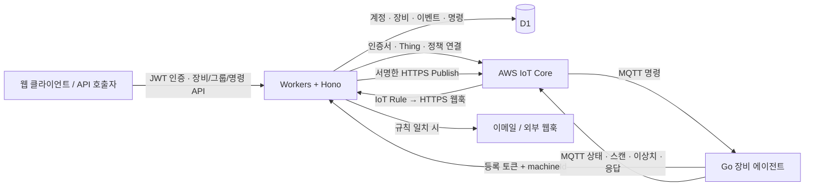

# SocQuery SaaS Backend

Go 장비 에이전트의 등록, 모니터링 이벤트, 원격 명령을 관리하는 백엔드 API입니다.

**백승규([decembaek](https://github.com/decembaek)) 개인 프로젝트 · 단독 설계·개발 · 역할 기여도 100%**

현재는 개발·로컬 검증 단계이며 지인 키오스크에 설치해 운영 효과를 측정하기 전입니다.
Cloudflare Workers·Hono·D1과 AWS IoT Core를 연결했습니다.
에이전트 코드는 [socquery-agent-go](https://github.com/decembaek/socquery-agent-go)에 있습니다.

## 해결하려는 문제

지인에게서 키오스크와 카드 단말기 등 주변 장비가 자주 고장 난다는 이야기를 듣고 시작했습니다. 원격에서 장비 상태와 점검 결과를 모아 보고, 문제가 생겼을 때 확인할 정보를 남기는 관제 솔루션을 목표로 했습니다.

Go 에이전트에서 USB와 PC 상태를 수집하고, 이 서버에서 계정·장비·이벤트·명령 이력을 연결하도록 구현했습니다. 장비별 정보를 구분하고 요청한 점검의 결과를 추적하는 것이 백엔드의 역할입니다. 장비와 서버는 MQTT와 HTTP API로 연결됩니다.

현재의 USB 상태 수집은 카드 단말기의 결제 승인 장애를 직접 진단하지 않습니다. 단말기 전용 프로토콜이나 자동 복구는 현재 구현 범위에 포함하지 않습니다.

이 프로젝트의 에이전트는 장비에 설치되는 Go 프로그램입니다.
이 저장소는 웹 UI를 포함하지 않는 API 서버이며, 장비 프로그램은 별도 저장소입니다.

## 구현 범위

| 영역 | 현재 코드에 있는 기능 |
| --- | --- |
| 사용자·계정 | 회원가입, 로그인, 토큰 갱신·로그아웃, 내 정보, 계정 목록·전환, 비밀번호 변경 |
| 장비 등록 | 등록 토큰 발급·조회, 만료·사용 여부 확인, AWS 인증서·Thing 프로비저닝 |
| 장비 관리 | 계정별 목록·상세·수정·삭제, 그룹 분류, 이벤트·명령 이력 조회 |
| 명령 전달 | AWS IoT HTTPS Publish, 명령 상태 기록, 응답 웹훅으로 결과 반영 |
| 모니터링 | 상태·스캔·시스템·이상치 이벤트 수신, 마지막 통신 시각과 이력 저장 |
| 알림 | 그룹 규칙, 발생 이력, 5분 쿨다운, 이메일·웹훅 채널과 템플릿 |
| 데이터 | 계정·사용자·장비·그룹·이벤트·명령·알림의 SQL 마이그레이션 8개 |

구현 위치와 설계는 아래에, 실행 확인 범위는 검증 항목에 정리했습니다.

## 문제를 기능으로 옮긴 과정

| 관리하려는 문제 | 구현한 접근 | 남기는 정보 |
| --- | --- | --- |
| 장비와 소속을 구분 | 계정·장비 등록과 그룹 관리 | 장비 식별자와 소속 |
| 상태 변화를 모아 확인 | 상태·스캔·이상 이벤트 웹훅 | 최근 통신과 이벤트 이력 |
| 점검 요청의 결과 추적 | 명령 ID와 전달·완료 상태 분리 | 요청·발행·응답 상태 |
| 이상 상황 알림 | 그룹 규칙과 알림 채널 | 조건에 맞는 발생 기록과 전송 경로 |

역할 기여도 100%는 두 저장소를 혼자 설계·개발했다는 의미입니다. 외부 라이브러리와 클라우드 서비스를 활용했으며, 장애·출동·점검 시간의 감소율은 아직 측정하지 않았습니다.

## 전체 구조



1. 사용자가 로그인한 계정에서 장비 등록 토큰을 발급합니다.
2. Go 에이전트가 토큰과 장비 식별자를 보내면 서버가 AWS IoT 연결 정보를 발급합니다.
3. 에이전트의 MQTT 메시지는 별도로 구성한 IoT Rule을 거쳐 서버 웹훅으로 전달됩니다.
4. 서버는 이벤트와 장비 상태를 저장하고, 이상치에 그룹 규칙·알림 채널을 적용합니다.
5. 명령 API는 MQTT로 발행한 뒤 응답 웹훅을 통해 실행 결과를 기록합니다.

AWS IoT 정책·Rule·IAM 권한·HTTPS Action 설정은 별도 준비가 필요합니다.
저장소에 이를 일괄 구성하는 인프라 자동화 코드는 포함되어 있지 않습니다.
등록 API가 참조하는 정책 이름은 `src/routes/agents.ts`의 `policyName` 상수와 맞아야 합니다.

## 설계와 기술의 역할

| 구성 | 코드에서 맡는 역할 |
| --- | --- |
| TypeScript·Hono | API 라우팅, 인증 미들웨어, 요청·응답 처리 |
| Cloudflare Workers | HTTP 요청을 처리하는 실행 환경 |
| D1 | 계정과 장비의 관계, 이벤트·명령·알림 이력을 SQL로 저장 |
| AWS IoT Core | 장비 인증서·Thing 관리, 에이전트와 MQTT 메시지 교환 |
| aws4fetch | AWS API 요청에 SigV4 서명을 적용 |
| Web Crypto·Hono JWT | PBKDF2 비밀번호 해싱, 토큰 난수·해시, HS256 액세스 토큰 |
| Resend / HTTP 웹훅 | 그룹 알림의 외부 전송 경로 |

### 계정과 장비 등록을 분리

일반 관리 API는 JWT의 `account_id`를 기준으로 장비·그룹을 조회합니다.
장비 등록은 사용자 JWT 대신 등록 토큰을 사용하며, 토큰에 연결된 계정·그룹을 상속합니다.
등록 토큰은 난수로 만들고 DB에는 SHA-256 해시를 저장합니다.
기본 유효 시간은 1시간이며, 코드상 최대값은 24시간입니다.

### 사용자 세션과 장비 인증의 수명을 구분

액세스 토큰은 기본 15분, refresh token은 기본 7일입니다.
Refresh token은 해시 저장·회전·폐기하며, 비밀번호 변경 시 해당 사용자의 refresh token을 폐기합니다.
발급된 액세스 토큰을 즉시 무효화하는 별도 목록은 구현되어 있지 않습니다.
장비 연결 정보는 AWS 프로비저닝 이후 등록 응답으로 반환합니다.

### 명령의 전달과 실행 결과를 구분

명령을 D1에 `pending`으로 저장하고 AWS Publish 성공 시 `delivered`로 변경합니다.
이 상태는 AWS가 발행 요청을 수락했다는 뜻입니다.
장비 실행 성공은 응답 웹훅의 `exitCode === 0`을 받아 `completed`로 기록할 때 구분합니다.
`timeout` 값은 저장·전달하지만, 응답 누락을 자동으로 만료 처리하는 작업은 없습니다.

### 이상치 규칙과 전송 채널을 분리

그룹마다 지표·비교 연산·임계값·지속 시간과 이메일/웹훅 채널을 설정합니다.
이상치의 `details` 등을 비교해 조건이 맞으면 발생 이력을 저장한 뒤 알림을 보냅니다.
같은 규칙·장비의 최근 발생 이력이 있으면 5분 동안 알림을 건너뜁니다.
이는 현재 구현 방식이며 중복 전송이나 유실이 없다는 보장은 아닙니다.

구현 위치: [인증](src/routes/auth.ts), [장비·그룹·명령](src/routes/agents.ts),
[이벤트·알림](src/routes/iot.ts), [암호화 유틸리티](src/utils/crypto.ts).

## 로컬 빠른 시작

Node.js와 npm이 필요합니다. lockfile의 Wrangler 4.63.0은 Node.js `>=20.0.0`을 요구합니다.
의존성은 저장소의 lockfile로 설치합니다.

```sh
git clone https://github.com/decembaek/socquery-saas-backend.git
cd socquery-saas-backend
npm ci
```

프로젝트 루트에 아래 `.dev.vars`를 직접 만들고 로컬 전용 값으로 바꿉니다.
이 파일은 Git 추적 대상에서 제외되어 있습니다.

```dotenv
JWT_SECRET="<local-development-signing-secret>"
IOT_WEBHOOK_SECRET="<local-development-webhook-secret>"
```

`wrangler.jsonc`의 D1 바인딩 이름은 `DB`입니다.
로컬 마이그레이션과 서버 시작은 다음과 같습니다.

```sh
npm run seedLocalDb
npx wrangler dev
```

`seedLocalDb`는 `wrangler d1 migrations apply DB --local`을 실행합니다.
`npm run dev`를 사용하면 로컬 마이그레이션과 서버 시작을 순서대로 수행합니다.
Wrangler가 표시한 주소에서 확인합니다. 기본 주소를 사용한 예시는 다음과 같습니다.

```sh
curl http://127.0.0.1:8787/api/v1/health
```

로컬 D1과 인증 API는 AWS 자격증명 없이 확인할 수 있습니다.
장비 등록·삭제·명령 발행은 로컬 서버에서도 실제 AWS HTTP 요청을 수행합니다.
알림 채널을 활성화하면 실제 이메일·외부 웹훅 요청도 수행합니다.
빠른 시작은 AWS·Resend가 필요한 기능까지 가상화하는 환경이 아닙니다.

### 환경 변수와 바인딩

| 이름 | 쓰임 | 필요한 범위 |
| --- | --- | --- |
| `DB` | Cloudflare D1 바인딩 | DB를 사용하는 API |
| `JWT_SECRET` | HS256 액세스 토큰 서명·검증 | 인증·관리 API |
| `JWT_ACCESS_EXPIRES_IN` | 액세스 토큰 수명(초), 기본 `900` | 설정값·기본값 사용 가능 |
| `JWT_REFRESH_EXPIRES_IN` | refresh token 수명(초), 기본 `604800` | 설정값·기본값 사용 가능 |
| `AWS_ACCESS_KEY_ID` | AWS 요청 서명용 자격증명 | 프로비저닝·삭제·명령 발행 |
| `AWS_SECRET_ACCESS_KEY` | AWS 요청 서명용 자격증명 | 프로비저닝·삭제·명령 발행 |
| `AWS_REGION` | AWS IoT API 리전 | AWS 연동 |
| `IOT_ATS_ENDPOINT` | 스킴 없는 IoT Data endpoint 호스트 | 등록 응답·명령 발행 |
| `IOT_WEBHOOK_SECRET` | `X-IoT-Secret` 헤더와 비교 | 이벤트 웹훅 |
| `RESEND_API_KEY` | Resend API 인증 | 이메일 알림 사용 시 |
| `RESEND_FROM_EMAIL` | Resend 발신 주소 | 이메일 알림 사용 시 |
| `AWS_ACCOUNT_ID` | Wrangler 설정에 있는 값, 현재 소스에서는 미사용 | 현 API의 필수 입력 아님 |

추가 연동값은 `.dev.vars`에 본인 환경에 맞게 설정합니다.
예를 들어 `IOT_ATS_ENDPOINT="<your-endpoint>-ats.iot.<region>.amazonaws.com"`처럼
호스트만 입력하며 실제 운영 자격증명·endpoint·계정 ID를 문서나 예제에 넣지 않습니다.
배포 환경은 본인의 D1과 AWS 리소스로 구성하고, 민감값은 Worker secrets로 관리합니다.
`src/types.ts`의 수동 바인딩 타입과 `worker-configuration.d.ts`의 생성 타입은 구분되어 있습니다.
Wrangler 설정을 바꾼 뒤에는 `npm run cf-typegen`으로 생성 타입을 갱신할 수 있습니다.

## API 핵심 요약

모든 경로의 공통 접두사는 `/api/v1`입니다.
JWT는 `Authorization: Bearer <access-token>` 헤더로 전달합니다.

| 메서드·경로 | 인증 | 역할 |
| --- | --- | --- |
| `GET /health` | 없음 | 서버 응답 확인 |
| `POST /auth/register`, `POST /auth/login` | 없음 | 가입·로그인 |
| `POST /auth/refresh` | refresh token | 토큰 갱신 |
| `POST /auth/logout`, `PUT /auth/password` | JWT | 세션 폐기·비밀번호 변경 |
| `GET /auth/me`, `GET /auth/accounts` | JWT | 사용자·소속 계정 조회 |
| `POST /auth/switch-account` | JWT | 소속 확인 후 계정 전환 |
| `POST /agents/tokens`, `GET /agents/tokens` | JWT | 등록 토큰 발급·조회 |
| `POST /agents/register` | 등록 토큰 | 장비 프로비저닝 |
| `GET /agents`, `GET/PUT/DELETE /agents/:id` | JWT | 장비 관리 |
| `GET /agents/:id/events` | JWT | 이벤트 이력 |
| `POST/GET /agents/:id/commands` | JWT | 명령 발행·이력 |
| `GET/POST /agents/groups`, `GET/PUT/DELETE /agents/groups/:id` | JWT | 그룹 관리 |
| `GET/POST /agents/groups/:id/rules` | JWT | 규칙 조회·생성 |
| `PUT/DELETE /agents/groups/:groupId/rules/:ruleId` | JWT | 규칙 수정·삭제 |
| `GET/POST /agents/groups/:id/alert-channels` | JWT | 알림 채널 조회·생성 |
| `PUT/DELETE /agents/groups/:groupId/alert-channels/:channelId` | JWT | 채널 수정·삭제 |
| `GET /agents/groups/:id/alerts`, `GET /agents/groups/:id/alerts-summary` | JWT | 알림 이력·요약 |
| `GET /iot/webhook` | 없음 | `{ "ok": true }` 응답 |
| `POST /iot/webhook` | 공유 시크릿 | IoT 이벤트 수신 |

등록 토큰 발급에는 `display_name`이 필요하며 `group_id`, `expires_in`을 선택할 수 있습니다.
장비 등록 입력은 `{ "token": "<registration-token>", "machineId": "<machine-id>" }`입니다.
`free` 계정에는 현재 장비 수 3개 제한 검사 코드가 있습니다.
목록 API의 필터·페이지 매개변수와 전체 입력 필드는 각 라우트 소스를 기준으로 확인합니다.

## MQTT와 IoT 웹훅 계약

기준 토픽 구조는 `socquery/{tenant_id}/{thingName}/{category}/{action}`입니다.
서버는 Go 에이전트와 직접 MQTT 연결을 유지하지 않고 AWS HTTPS Publish API를 호출합니다.

### 서버에서 장비로 보내는 명령

발행 토픽은 `socquery/{account_id}/{thingName}/agent/command`, QoS는 `1`입니다.
HTTP 명령 API와 MQTT 메시지는 다음 필드를 사용합니다.

```json
{
  "commandId": "<command-id>",
  "action": "<agent-supported-action>",
  "params": {},
  "timeout": 30
}
```

`commandId`는 서버가 생성하며 HTTP 입력에는 `action`, 선택적 `params`·`timeout`을 보냅니다.
지원 action과 파라미터는 Go 에이전트 구현을 함께 확인해야 합니다.
서버와 에이전트의 필드·지원 명령 호환성을 검증한 통합 테스트는 아직 제공하지 않습니다.

### 장비에서 서버로 들어오는 이벤트

IoT Rule은 토픽의 계정·장비·분류를 추출해 다음과 같은 **최상위 필드**로 전달해야 합니다.
서버는 `event`와 중첩 `payload`만 있는 이전 예제를 그대로 해석하지 않습니다.

```json
{
  "thingName": "<registered-thing-name>",
  "tenantId": "<account-id>",
  "category": "agent",
  "action": "status",
  "status": "online",
  "os": "linux",
  "arch": "amd64",
  "version": "dev"
}
```

요청 경로는 `POST /api/v1/iot/webhook`이며 `X-IoT-Secret` 헤더가 필요합니다.
Rule의 변환 설정과 공유 시크릿은 별도로 맞춰야 하며 위 JSON은 서버 입력 예시입니다.

| `category` / `action` | 서버 처리 |
| --- | --- |
| `agent / status` | `status`, 선택적 `os/arch/version`으로 상태 갱신·이벤트 저장 |
| `agent / response` | `commandId/exitCode/data/error`로 명령 결과 갱신·이벤트 저장 |
| `scan / *` | 스캔 이벤트 저장 |
| `system / *` | 텔레메트리 이벤트 저장 |
| `anomaly / *` | 이상치 저장 후 그룹 규칙 비교·알림 |
| 기타 | `action`으로 해석을 시도하고 일치하지 않으면 텔레메트리로 저장 |

서버는 `thingName`으로 등록 장비를 찾고, 저장 시 해당 장비의 계정을 사용합니다.
요청의 `tenantId`와 장비 계정을 별도로 대조하는 검증은 현재 없습니다.
없는 장비는 `{ "ok": true, "warning": "unknown agent" }`로 응답합니다.
`last_seen_at`은 서버 수신 시각이며, 장비 타임스탬프를 기준으로 갱신하지 않습니다.

## 저장소 구조

```text
src/
  index.ts                 # /api/v1, CORS, logger, 라우트 연결
  routes/
    auth.ts                # 사용자·세션·계정 전환
    agents.ts              # 토큰·장비·그룹·규칙·명령 API
    iot.ts                 # 웹훅·이벤트 처리·알림 채널 전송
  middleware/auth.ts       # JWT 검증과 요청 컨텍스트
  utils/crypto.ts          # PBKDF2, SHA-256, UUID
  utils/jwt.ts             # HS256, refresh token 생성
  types.ts                 # 바인딩·요청 컨텍스트·DB 행 타입
migrations/                # 001~008, 순서대로 적용하는 D1 SQL
wrangler.jsonc             # Worker·D1·공개 설정
worker-configuration.d.ts   # Wrangler가 생성한 런타임·바인딩 타입
package-lock.json          # 재현 가능한 의존성 설치 기준
```

SQL은 계정·소속, 장비·등록 토큰, 그룹·규칙·채널, 이벤트·명령·알림 이력을 연결합니다.
그룹 분류, 웹훅 옵션, 장비 표시 이름과 알림 발생 이력을 순차 마이그레이션으로 추가했습니다.

## 검증 방법과 현재 범위

2026-11-05에 로컬 환경에서 다음 항목을 확인했습니다.
API 검증은 Wrangler의 `127.0.0.1` 서버와 로컬 D1을 사용했으며, 아래 10개 응답 확인이 모두 통과했습니다.

| 검증 항목 | 결과 |
| --- | --- |
| 의존성 설치 | `npm ci --ignore-scripts` 통과 |
| 정적 타입 검사 | 별도로 실행한 최신 TypeScript compiler의 `tsc --noEmit` 통과 |
| 로컬 DB | D1 마이그레이션 8개 적용 성공 |
| 기본 응답·인증 경계 | health `200`, 미인증 장비 조회 `401` |
| 가입·로그인 | 회원가입 `201`, 로그인 `200` |
| 인증 후 조회 | 내 정보 `200`, 장비 빈 목록 `200` |
| 토큰 회전 | refresh `200`, 기존 refresh token 재사용 `401` |
| 세션 폐기 | 로그아웃 `200`, 폐기한 refresh token 재사용 `401` |

토큰·비밀번호 값은 검증 출력이나 결과 파일에 남기지 않았습니다.
AWS·Resend 호출, Go 에이전트와의 실계정 통합, 실장비 운영·부하 테스트는 수행하지 않았습니다.
클라우드 배포 상태·가동률·성능·보안 수준을 이 로컬 결과로 보장하지 않습니다.

현재 `npm test`, lint, typecheck 전용 npm 스크립트는 없습니다.
위 확인은 저장소에 상시 실행 가능한 자동 테스트가 구축되어 있다는 뜻은 아닙니다.
다음 검증 대상으로는 AWS 모의 응답을 이용한 등록 중간 실패·중복 요청·명령 응답과,
별도 테스트 AWS 환경에서 에이전트·IoT Rule·웹훅의 전체 연결을 남겨 두었습니다.


## 알려진 제약과 다음 작업

- **통신 계약 검증:** Go 수신 형식과 서버 발행 형식, Rule의 평탄화 입력을 테스트로 고정할 예정입니다.
- **프로비저닝 일관성:** AWS 단계와 DB 저장을 하나의 트랜잭션으로 묶지 않았고, 중간 실패 시 보상 정리는 없습니다.
- **동시 요청:** 등록 토큰 사용 처리와 refresh 회전의 원자성·중복 요청 검증을 보완해야 합니다.
- **명령 타임아웃:** 타입·저장 필드는 있으나 응답 누락을 자동 만료 처리하는 스케줄러는 없습니다.
- **알림 전달:** 요청 처리 중 순차 전송하며 실패는 로그에 남깁니다. 재시도 큐·전송 성공 이력은 없습니다.
- **장비 삭제:** AWS 정리를 시도한 뒤 DB를 삭제합니다. AWS 요청 실패·잔여 리소스 정리는 보강 대상입니다.
- **입력·권한:** 요청 스키마와 역할별 권한, 웹훅의 계정 대조, 외부 전송 대상 검증을 더 엄격히 할 필요가 있습니다.
- **운영 설정:** 현재 CORS는 전체 origin 허용이며 observability 설정은 주석 상태입니다. 환경별 제한·관측을 보완할 예정입니다.

이 항목들은 개발 완료 목록과 구분한 후속 작업입니다.

## 참고 문서

- [Cloudflare D1 로컬 개발](https://developers.cloudflare.com/d1/best-practices/local-development/)
- [Wrangler D1 마이그레이션](https://developers.cloudflare.com/d1/wrangler-commands/#d1-migrations-apply)
- [Workers 로컬 시크릿](https://developers.cloudflare.com/workers/configuration/secrets/#local-development-with-secrets)
- [Workers Best Practices](https://developers.cloudflare.com/workers/best-practices/workers-best-practices/)

현재 별도 `LICENSE` 파일은 포함되어 있지 않습니다.
